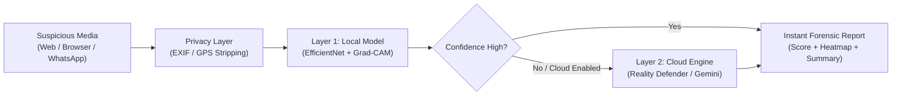

<div align="center">


# Trinetra (त्रिनेत्र) — Deepfake Forensic Analyzer

**Real-time AI deepfake detection and media authentication across the Web, Chrome, and WhatsApp.**

[](https://github.com/)
[](https://www.python.org/)
[](https://nextjs.org/)
[](https://developer.chrome.com/docs/extensions/mv3/intro/)
[](LICENSE)
[](https://github.com/)

[Key Features](#key-features) • [How It Works](#how-it-works) • [Quick Start](#quick-start) • [Project Structure](#project-structure) • [Chrome Extension](#chrome-extension-usage) • [WhatsApp Bot](#whatsapp-bot)

</div>

---

## About Trinetra

Named after the mythical Indian concept of the **"Third Eye of Truth"**, **Trinetra** is an open-source forensic platform built to detect AI-generated deepfakes, face swaps, and synthetic media. 

In an era of hyper-realistic digital manipulation, Trinetra gives journalists, researchers, and everyday users transparent, explainable proof of whether an image or video is real or fake — directly on your computer, in your browser, or over WhatsApp.

---

## Key Features

- **Dual-Layer Detection Engine**
  - **Local Model (Fast & Private):** Runs on your device using a lightweight CNN + Transformer hybrid model (`EfficientNet-V2-S`). Fast, free, and keeps your media private.
  - **Cloud Verification (High Accuracy):** Optional fallback integration with **Reality Defender** and **Google Gemini** for deep verification on tricky or ambiguous media.
- **Explainable AI (XAI)**
  - Generates **Grad-CAM visual heatmaps** showing the exact facial areas that were edited or artificially generated instead of just a raw percentage.
- **Modern Web Dashboard**
  - An interactive **Next.js 14** web app for deep investigations: view frame-by-frame timelines, compression error levels (ELA), and facial landmark jitter.
- **Chrome Extension (New White Theme)**
  - A clean, distraction-free browser extension. Highlight any image or video on Twitter, YouTube, or news websites to get an instant verdict right on the page.
- **WhatsApp Verification Bot**
  - Forward suspicious images directly to a WhatsApp chatbot to receive an instant fact-checking verdict in plain English.
- **Privacy-First Architecture**
  - Automatically strips GPS coordinates, camera serial numbers, and personal EXIF metadata before processing. Media is analyzed in memory without permanent storage. See [PRIVACY.md](PRIVACY.md) and [SECURITY.md](SECURITY.md) for full architectural details.

---

## How It Works



1. **Upload or Capture:** You select an image on a webpage, upload a file to the dashboard, or forward it via WhatsApp.
2. **Privacy Cleanse:** Trinetra immediately strips out private EXIF information like camera location and device serial numbers.
3. **Local Face Analysis:** The local neural network detects faces, checks for pixel blending anomalies, and produces a Grad-CAM heatmap.
4. **Cloud Verification (Optional):** If cloud analysis is turned on, media is cross-verified against cloud deepfake models for double confirmation.
5. **Clear Verdict:** You get a simple **REAL** or **FAKE** label, a confidence score, a visual heatmap, and a human-readable explanation.

---

## Project Structure

Trinetra is organized as a modular monorepo:

```text
Trinetra-v2.0/
├── backend/                  # Python FastAPI Backend & AI Models
│   ├── api.py                # REST API for the extension and web dashboard
│   ├── whatsapp_bot.py       # WhatsApp Cloud API webhook handler
│   ├── requirements.txt      # Python dependencies
│   ├── src/                  # Inference pipeline, Grad-CAM, and model code
│   └── tests/                # Automated backend test suite
│
├── frontend/                 # Next.js 14 Web Dashboard
│   ├── src/app/              # Next.js App Router pages and routes
│   ├── src/components/       # UI components (Heatmap viewer, gauge, uploaders)
│   ├── tailwind.config.ts    # Tailwind styling tokens
│   └── package.json          # Node.js dependencies
│
├── extension/                # Chrome / Chromium Browser Extension (Manifest V3)
│   ├── popup.html / .css     # Clean white-themed extension popup UI
│   ├── content.js / .css     # In-page region selector, modal, and mandala spinner
│   ├── background.js         # Service worker handling API communication
│   ├── preview.html          # Interactive standalone preview page
│   └── manifest.json         # Chrome extension configuration
│
└── README.md                 # Project documentation
```

---

## Quick Start

### 1. Prerequisites

Make sure you have the following installed on your computer:
- **Python:** Version 3.10 or higher ([Download Python](https://www.python.org/))
- **Node.js:** Version 18 or higher ([Download Node.js](https://nodejs.org/))
- **Git:** ([Download Git](https://git-scm.com/))

---

### 2. Setting Up the Backend (FastAPI)

1. Open your terminal and navigate to the `backend` folder:
   ```bash
   cd backend
   ```

2. Create and activate a Python virtual environment:
   ```bash
   # On Windows:
   python -m venv venv
   .\venv\Scripts\activate

   # On macOS / Linux:
   python3 -m venv venv
   source venv/bin/activate
   ```

3. Install the required Python packages:
   ```bash
   pip install -r requirements.txt
   ```

4. Create a `.env` file in the `backend` directory (optional for cloud features):
   ```env
   TRINETRA_API_KEY=trinetra_local_dev_token_2026
   RD_API_KEY=your_reality_defender_api_key_here
   GEMINI_API_KEY=your_google_gemini_api_key_here
   ```

5. Start the backend server:
   ```bash
   python api.py
   ```
   *The backend runs at `http://127.0.0.1:8000`.* Interactive API documentation is available at `http://127.0.0.1:8000/docs`.

---

### 3. Setting Up the Web Dashboard (Next.js)

1. Open a new terminal window and navigate to the `frontend` folder:
   ```bash
   cd frontend
   ```

2. Install the JavaScript packages:
   ```bash
   npm install
   ```

3. Start the Next.js development server:
   ```bash
   npm run dev
   ```
   *Open [http://localhost:3000](http://localhost:3000) in your browser to view the deep forensics dashboard.*

---

### 4. Setting Up the Chrome Extension

1. Open **Google Chrome** (or any Chromium browser like Brave, Edge, or Arc).
2. Go to `chrome://extensions/` in the address bar and press Enter.
3. Turn on the **"Developer mode"** toggle in the top-right corner.
4. Click the **"Load unpacked"** button in the top-left.
5. Select the `extension/` folder inside this repository.
6. The **Trinetra** icon will appear in your browser toolbar.

> **Quick Testing:** You can test the extension's white-theme UI anytime by opening `extension/preview.html` directly in your browser.

---

## Chrome Extension Usage

1. Click the **Trinetra** icon in your browser toolbar.
2. Ensure the **Local Model** toggle is turned on.
3. Click the **SCAN REGION** button.
4. Click and drag your mouse across any image, video, or face on any webpage.
5. The extension will highlight the selection, display an animated mandala loader, and pop up a forensic card with:
   - Primary Verdict (**REAL** or **FAKE**)
   - Confidence percentage
   - Source face extraction and Grad-CAM heatmap
   - One-click **Copy Report** button for easy reporting

---

## WhatsApp Bot

Trinetra includes a ready-to-use WhatsApp bot for community fact-checking:

1. In your `backend/.env` file, provide your Meta Cloud API credentials:
   ```env
   WHATSAPP_ACCESS_TOKEN=your_token_here
   WHATSAPP_PHONE_NUMBER_ID=your_phone_id_here
   WHATSAPP_VERIFY_TOKEN=your_chosen_verify_token
   ```
2. Run the bot webhook:
   ```bash
   cd backend
   python whatsapp_bot.py
   ```
3. Expose port `5000` via [ngrok](https://ngrok.com/) or your cloud server to receive webhooks from Meta.

---

## Testing

To run the automated backend test suite:

```bash
cd backend
pytest tests/ -v
```

---

## Contributing

Contributions make the open-source community an amazing place to learn and build. Any contributions you make to Trinetra are appreciated:

1. Fork the Project
2. Create your Feature Branch (`git checkout -b feature/AmazingFeature`)
3. Commit your Changes (`git commit -m 'Add some AmazingFeature'`)
4. Push to the Branch (`git push origin feature/AmazingFeature`)
5. Open a Pull Request

---

## Privacy and Security

Trinetra is built with a Privacy-by-Design and defense-in-depth architecture:
- Review our [User Privacy Policy](USER_PRIVACY.md) for details on metadata stripping, local-first inference, and cloud opt-in.
- Review our [Security Architecture](SECURITY.md) for vulnerability reporting guidelines, authentication mechanisms, and hardening controls.

---

## License

This project is licensed under the MIT License. See the [LICENSE](LICENSE) file for more information.

---

<div align="center">
  <sub>Built for digital truth and media integrity.</sub>
</div>
